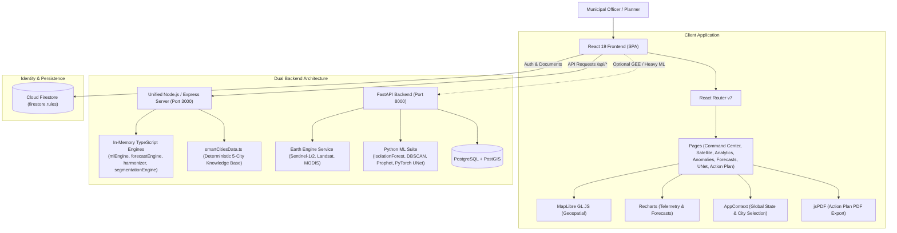

# System Architecture Map

## High-Level Architectural Overview

PRATYAKSHA utilizes a dual-tier architecture designed for rapid development, deterministic testing, and enterprise-grade scalability.



## Core Architectural Patterns

### 1. Unified Embedded Server Pattern (`server.ts`)
- Serves both the compiled React frontend (or attaches Vite HMR middleware in development) and all `/api/*` REST endpoints on port 3000.
- Implements TypeScript versions of all ML algorithms (Isolation Forest path length, Autoencoder MSE, Haversine DBSCAN, Prophet curve simulation, UNet segmentation metrics).
- Guarantees complete end-to-end functionality out of the box with zero external dependencies (no database or GEE credentials required for evaluation).

### 2. Specialized Heavy Compute Service (`backend/`)
- Python 3.11+ FastAPI service dedicated to heavy geospatial processing.
- Handles direct Earth Engine API authentication and raw GeoTIFF raster extraction.
- Exposes REST endpoints for satellite harmonization and Prophet forecasting.

### 3. Explainable Multi-Model Risk Consensus
Rather than relying on a single black-box score, PRATYAKSHA calculates an explainable composite risk score ($0 - 100$) for each municipal ward:
$$\text{Consensus Score} = C_{\text{IF}} (38\%) + C_{\text{AE}} (28\%) + C_{\text{Threshold}} (24\%) + C_{\text{Spatial}} (10\%)$$
- **Isolation Forest ($C_{\text{IF}}$)**: Evaluates multidimensional multivariate anomaly likelihood.
- **Autoencoder MSE ($C_{\text{AE}}$)**: Quantifies non-linear reconstruction residual against normal baselines.
- **Domain Threshold ($C_{\text{Threshold}}$)**: Incorporates hard municipal environmental thresholds (e.g. LST $> 42^\circ\text{C}$, NDVI $< 0.15$).
- **DBSCAN Spatial Hotspot ($C_{\text{Spatial}}$)**: Adds spatial clustering weight if adjacent wards exhibit concurrent anomalies.

### 4. Data Flow Pipeline
```
[Satellite Missions]
      │
      ▼
[Geospatial Harmonization] (CRS Reprojection, Bilinear/Bicubic Resampling, Cloud Masking)
      │
      ▼
[Ward Telemetry & Indicators] (LST, NDVI, NO₂, AQI, Water Body Surface Area)
      │
      ▼
[Anomaly Detection & Clustering] (Isolation Forest + Autoencoder MSE + DBSCAN)
      │
      ▼
[Explainable Risk Consensus] (0 - 100 Composite Score + Severity Classification)
      │
      ▼
[Predictive Forecasting] (Prophet, ARIMA, XGBoost with Confidence Envelopes)
      │
      ▼
[Action Plan Synthesis] (Executive Summary, Municipal Interventions, PDF/JSON Export)
```

## State Management & Frontend Architecture
- **Context API (`src/context/AppContext.tsx`)**: Manages active municipality (`ahmedabad`, `delhi`, `mumbai`, `bengaluru`, `chennai`), active map layers, date range filters, and global application state.
- **Page Modularity**:
  - `CommandCenter.tsx`: Executive dashboard with map and 6 environmental KPIs.
  - `SatelliteExplorer.tsx`: Catalog search, spectral band inspection, and harmonization pipeline.
  - `EnvironmentalAnalytics.tsx`: Deep-dive Recharts modules for each environmental dimension.
  - `AnomalyDetection.tsx`: Real-time anomaly inspection, DBSCAN cluster visualization, and triage review drawer.
  - `ForecastingEngine.tsx`: Multi-model forecast comparative benchmarks.
  - `LandCoverSegmentation.tsx`: 6-class land cover inspection with canvas overlay and transition matrix.
  - `ActionPlan.tsx`: Policy action plan generator and PDF exporter.
