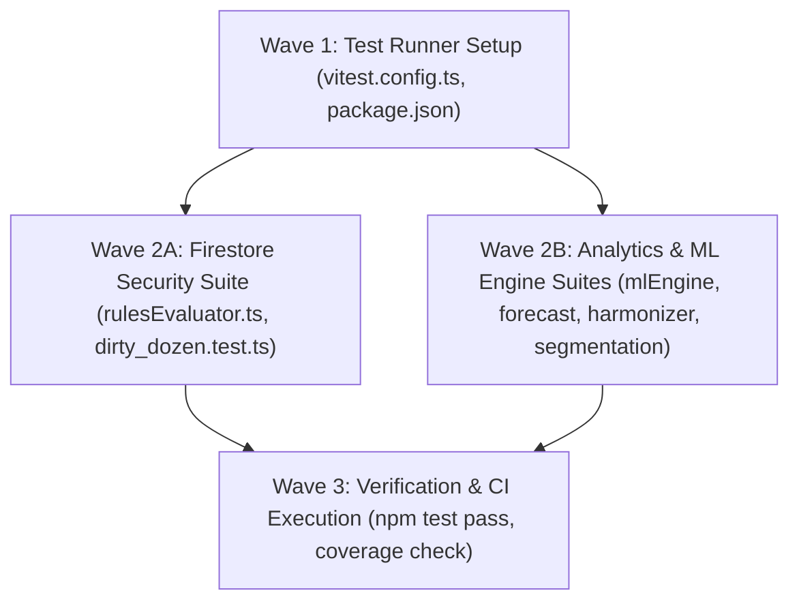

# Phase 2 Plan: Security & Test Automation Harness

## Goal
Implement an automated test harness covering the 12 "Dirty Dozen" Firestore security vectors and all 4 in-memory TypeScript analytics engines (`mlEngine`, `forecastEngine`, `harmonizer`, `segmentationEngine`), wired into `package.json` for CI validation.

---

## Execution Waves

---

## Task Breakdown

### Wave 1: Test Runner Infrastructure
- **Task 1.1**: Create `vitest.config.ts` configured for TypeScript ESM execution, matching `vite.config.ts` path resolutions.
- **Task 1.2**: Update `package.json` with test scripts:
  - `"test": "vitest run"`
  - `"test:security": "vitest run tests/security"`
  - `"test:engines": "vitest run tests/engines"`

### Wave 2A: Firestore Security & "Dirty Dozen" Suite
- **Task 2.1**: Implement `tests/security/rulesEvaluator.ts`:
  - Enforce rules predicates: `isSignedIn()`, `isVerified()`, `isOwner()`, `isAdmin()`, `isValidId()`.
  - Enforce entity schemas: `isValidUserProfile()`, `isValidActionPlan()`, `isValidAnomalyReview()`, `isValidProcessingJob()`.
  - Enforce terminal state locks: archived plans, resolved reviews, completed jobs.
  - Enforce temporal and owner immutability: `createdAt`, `ownerId`.
- **Task 2.2**: Implement `tests/security/dirty_dozen.test.ts`:
  - DD-01: Unauthenticated read on `/action_plans` $\to$ `PERMISSION_DENIED`
  - DD-02: Unverified email write on `/action_plans` $\to$ `PERMISSION_DENIED`
  - DD-03: Shadow field `role: 'admin'` injection on user profile $\to$ `PERMISSION_DENIED`
  - DD-04: Shadow field injection on action plan $\to$ `PERMISSION_DENIED`
  - DD-05: Cross-user `ownerId` spoofing on anomaly review $\to$ `PERMISSION_DENIED`
  - DD-06: Cross-user PII read on `/users` $\to$ `PERMISSION_DENIED`
  - DD-07: ID poisoning ($>128$ chars or illegal characters) $\to$ `PERMISSION_DENIED`
  - DD-08: Terminal state mutation on archived action plan $\to$ `PERMISSION_DENIED`
  - DD-09: Immutable field tampering (`createdAt`, `ownerId`) $\to$ `PERMISSION_DENIED`
  - DD-10: Client timestamp spoofing $\to$ `PERMISSION_DENIED`
  - DD-11: Unbounded array poisoning ($>10$ priority actions) $\to$ `PERMISSION_DENIED`
  - DD-12: Blanket list scraping across tenants $\to$ `PERMISSION_DENIED`
  - Positive tests: Valid authenticated owner creation and retrieval for all entities.

### Wave 2B: Analytics & ML Engine Test Suites
- **Task 2.3**: Implement `tests/engines/mlEngine.test.ts`:
  - `scoreWard`: Verifies Isolation Forest score in $[0.15, 0.96]$, Autoencoder MSE in $[0.04, 0.95]$.
  - `SpatialClusterAnalyzer`: Verifies Haversine DBSCAN spatial grouping of neighboring coordinates within 12.5 km.
  - `EnvironmentalRiskConsensus`: Tests weight contributions ($C_{\text{IF}} \le 38, C_{\text{AE}} \le 28, C_{\text{thresh}} \le 24, C_{\text{spatial}} \le 10$), score clamped $0-100$, and severity assignment.
- **Task 2.4**: Implement `tests/engines/forecastEngine.test.ts`:
  - Verifies 7, 30, and 90 day forecasts for Prophet, ARIMA, and XGBoost.
  - Verifies confidence intervals enclose the mean predicted trajectory.
  - Verifies accuracy benchmark metrics (RMSE, MAE, MAPE).
- **Task 2.5**: Implement `tests/engines/harmonizer.test.ts`:
  - Verifies CRS normalization (UTM to EPSG:4326).
  - Verifies bilinear/bicubic resampling calculations.
  - Verifies cloud coverage filtering ($>25\%$ dropped).
- **Task 2.6**: Implement `tests/engines/segmentationEngine.test.ts`:
  - Verifies 6-class land cover distributions sum to $100\%$.
  - Verifies 5-year transition matrix row probability validity ($\sum P = 1.0$).

### Wave 3: Verification & Quality Gate
- **Task 3.1**: Execute `npm test` and ensure all test suites pass with $100\%$ green assertions.
- **Task 3.2**: Execute `npm run lint` and verify zero type regressions.
- **Task 3.3**: Document test results and update `STATE.md`.

---

## Verification Criteria
- [ ] `vitest.config.ts` created and operational.
- [ ] All 12 Dirty Dozen security adversarial test cases pass.
- [ ] Positive authorized operations on Firestore collections pass.
- [ ] All 4 engine test suites pass with robust mathematical assertions.
- [ ] `npm test` runs cleanly and exits with code 0.
