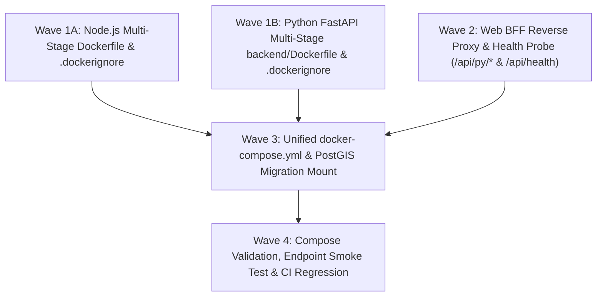

# Phase 3 Plan: Multi-Service Containerization & Local Compose Verification

## Goal
Containerize the PRATYAKSHA dual-service architecture (Node.js 24 Web/BFF + Python 3.11 FastAPI GIS engine) using multi-stage, production-hardened Dockerfiles with CPU-optimized geospatial dependencies, author a unified `docker-compose.yml` with PostGIS 15, wire internal reverse proxying (`/api/py/*`) in `server.ts`, and verify local orchestration with deterministic fallback guarantees.

---

## Requirements Covered
- **REQ-DEP-01**: Multi-stage Docker packaging (`Dockerfile` with Node 24 Alpine, `backend/Dockerfile` with Python 3.11 Debian Bookworm and CPU-only PyTorch).
- **REQ-DEP-02**: Local Docker Compose verification (`docker-compose.yml` orchestrating `web`, `backend`, and `postgis` services with health check dependencies and volume mounting).
- **REQ-RES-01**: Deterministic synthetic fallback assurance (containers boot cleanly and pass `/api/health` without requiring active GEE credentials or database connections).

---

## Execution Waves

---

## Task Breakdown

### Wave 1: Multi-Stage Container Dockerfiles & Ignore Configs

#### Task 1.1: Root `Dockerfile` (Node.js 24 + Express 5 + React 19 SPA)
- **Base image**: `node:24-alpine` for minimal attack surface.
- **Stage 1 (`builder`)**:
  - Install dependencies (`package.json`, `package-lock.json` if present).
  - Copy application source (`src/`, `index.html`, `vite.config.ts`, `tsconfig.json`).
  - Run `npm run build` to compile the React 19 SPA into optimized static assets in `/app/dist`.
- **Stage 2 (`runner`)**:
  - Minimal Node 24 Alpine runtime.
  - Set `NODE_ENV=production`.
  - Install production dependencies and `tsx` for TypeScript server execution.
  - Copy compiled `dist/` from builder.
  - Copy `server.ts`, `src/server/`, `src/shared/`.
  - Expose `PORT` (default 3000).
  - Switch to unprivileged `node` user for least-privilege container execution.
  - Configure `HEALTHCHECK` probing `http://localhost:${PORT}/api/health`.
  - Set entrypoint: `["node", "--loader", "tsx", "server.ts"]` or `["npx", "tsx", "server.ts"]`.

#### Task 1.2: Root `.dockerignore`
- Exclude build caches, local state, and secrets:
  - `node_modules/`
  - `dist/`
  - `.git/`
  - `.planning/`
  - `tests/`
  - `coverage/`
  - `.env*`
  - `backend/`
  - `*.log`

#### Task 1.3: `backend/Dockerfile` (Python 3.11 + FastAPI + PyTorch CPU + Geospatial)
- **Base image**: `python:3.11-slim-bookworm` (Debian Bookworm) for C-extension compatibility (`gdal`, `rasterio`, `geopandas`, `shapely`, `psycopg2`).
- **Optimization Strategy**:
  - Install essential system packages: `curl`, `gcc`, `libpq-dev`, `gdal-bin`, `libgdal-dev`.
  - Pre-install CPU-only PyTorch wheel via `--index-url https://download.pytorch.org/whl/cpu` to avoid downloading ~2.5 GB of unused CUDA packages.
  - Install `requirements.txt`.
- **Security & Runtime**:
  - Create non-root system user `appuser` (`uid=10001`).
  - Set `PYTHONUNBUFFERED=1`, `PYTHONDONTWRITEBYTECODE=1`, `PORT=8000`, `DEMO_MODE=true`.
  - Switch to user `appuser`.
  - Expose port 8000.
  - Configure `HEALTHCHECK` probing `http://localhost:8000/api/health`.
  - Set command: `["uvicorn", "backend.main:app", "--host", "0.0.0.0", "--port", "8000"]`.

#### Task 1.4: `backend/.dockerignore`
- Exclude Python caches and local artifacts:
  - `__pycache__/`
  - `*.py[cod]`
  - `*.so`
  - `.venv/`
  - `venv/`
  - `.pytest_cache/`
  - `.git/`
  - `.env*`

---

### Wave 2: Inter-Service Reverse Proxy & Health Probe

#### Task 2.1: Reverse Proxy Delegation in `server.ts`
- Implement an HTTP forwarding handler in Express for `/api/py/*`:
  - Target URL resolved from `process.env.PYTHON_SERVICE_URL || 'http://localhost:8000'`.
  - Strips `/api/py` prefix and forwards to `${PYTHON_SERVICE_URL}/api/*` (or preserves full path matching FastAPI route schema).
  - Handles GET, POST, PUT, DELETE with body streaming and header propagation.
  - Implements defensive timeout (5000ms) and graceful error handling returning 502/503 with informative JSON error if Python service is unavailable, preserving ADR-02 without crashing the Web BFF.

#### Task 2.2: Enhanced Unified Health Check (`/api/health`)
- Update `/api/health` in `server.ts` to report:
  - `status: "healthy"`
  - `service: "PRATYAKSHA Web BFF"`
  - `node_version`: `process.version`
  - `uptime`: `process.uptime()`
  - `python_service`: status from `${PYTHON_SERVICE_URL}/api/health` (probed with a short 1.5s timeout, marked `connected` or `unreachable/offline`).
  - `earthEngineMode`: live credentials vs demo fallback.

---

### Wave 3: Unified Docker Compose Specification & PostGIS Initialization

#### Task 3.1: Multi-Container `docker-compose.yml`
- Define 3 coordinated services:
  1. **`db`** (`postgis/postgis:15-3.4-alpine`):
     - Port: `5432:5432`
     - Environment: `POSTGRES_DB=pratyaksha`, `POSTGRES_USER=pratyaksha`, `POSTGRES_PASSWORD=pratyaksha_local_secret`
     - Volume mounts:
       - `./backend/database/migrations/001_init_postgis.sql:/docker-entrypoint-initdb.d/001_init_postgis.sql:ro`
       - `postgis_data:/var/lib/postgresql/data`
     - Health check: `pg_isready -U pratyaksha -d pratyaksha` (interval 5s, timeout 3s, retries 5).
  2. **`backend`** (Python FastAPI):
     - Build context: `./backend` with `Dockerfile: Dockerfile`
     - Port: `8000:8000`
     - Environment:
       - `DATABASE_URL=postgresql://pratyaksha:pratyaksha_local_secret@db:5432/pratyaksha`
       - `DEMO_MODE=true`
       - `CORS_ORIGINS=http://localhost:3000,http://web:3000`
     - Depends on: `db` (`condition: service_healthy`)
     - Health check: `curl -f http://localhost:8000/api/health || exit 1`
  3. **`web`** (Node.js 24 BFF):
     - Build context: `.` with `Dockerfile: Dockerfile`
     - Port: `3000:3000`
     - Environment:
       - `PORT=3000`
       - `NODE_ENV=production`
       - `PYTHON_SERVICE_URL=http://backend:8000`
     - Depends on: `backend` (`condition: service_healthy`)
     - Health check: `node -e "require('http').get('http://localhost:3000/api/health', (r) => {if(r.statusCode!==200)process.exit(1)})"`
- Shared bridge network `pratyaksha-network`.
- Persistent named volume `postgis_data`.

#### Task 3.2: Database Initialization Validation
- Verify `backend/database/migrations/001_init_postgis.sql` compatibility with PostgreSQL 15 and PostGIS 3.4.

---

### Wave 4: Validation & Quality Gate

#### Task 4.1: Compose Specification Validation
- Validate compose file with `docker-compose config` to ensure zero syntax or dependency ordering issues.

#### Task 4.2: Automated Container Specification Verification Script
- Create `tests/containerization/verify_compose_spec.test.ts` (or standalone runner) verifying:
  - `Dockerfile` multi-stage targets (`builder`, `runner`), non-root user, exposed ports, and healthcheck.
  - `backend/Dockerfile` multi-stage structure, PyTorch CPU wheel flag, non-root user, and healthcheck.
  - `docker-compose.yml` service dependencies, volumes, networks, and environment variables.
  - `.dockerignore` file coverage.

#### Task 4.3: Full Regression Test Execution
- Run `npm test` verifying 31/31 security and engine tests pass with zero regressions.
- Verify TypeScript syntax check passes cleanly.

---

## Verification Criteria
- [ ] Multi-stage `Dockerfile` created with Node 24 Alpine, builder + runner stages, and non-root execution.
- [ ] Root `.dockerignore` created excluding development and sensitive artifacts.
- [ ] Multi-stage `backend/Dockerfile` created with Python 3.11 Debian Bookworm, CPU-only PyTorch, and non-root `appuser`.
- [ ] `backend/.dockerignore` created.
- [ ] `server.ts` updated with `/api/py/*` reverse proxy delegation and enhanced `/api/health`.
- [ ] `docker-compose.yml` created linking `web`, `backend`, and `db` (PostGIS) on a shared bridge network.
- [ ] `docker-compose config` syntax validation passes with exit code 0.
- [ ] All 31 existing security and engine tests pass without regression.
